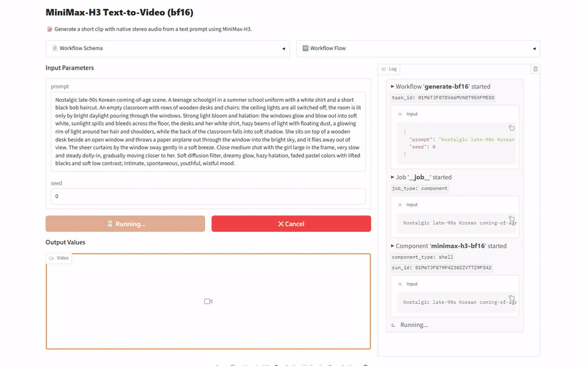
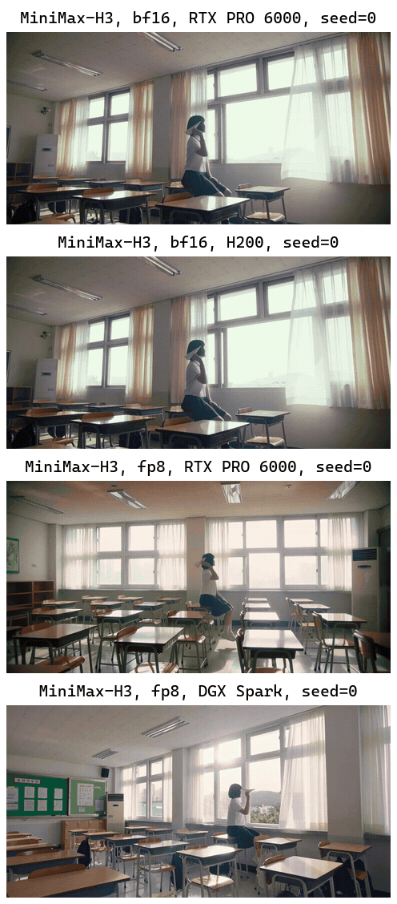

[English](README.md) · [한국어](README.ko.md) · [中文](README.zh.md)

# text-to-video-minimax-h3

이 서비스는 영어 프롬프트를 받아 MiniMaxAI/MiniMax-H3로 소리가 함께 들어간 짧은 영상을 만들어 영상 파일로 돌려줍니다.



## 빠른 시작

[model-compose](https://github.com/hanyeol/model-compose) 0.4.122 이상이 필요합니다.

[uv](https://docs.astral.sh/uv/)로 설치:

```bash
uv pip install model-compose
```

또는 pip로 설치:

```bash
pip install model-compose
```

이 저장소 클론:

```bash
git clone https://github.com/MindrLabs/text-to-video-minimax-h3
cd text-to-video-minimax-h3
```

실행:

```bash
model-compose up
```

API 주소는 http://localhost:8080/api, Gradio UI 주소는 http://localhost:8081 입니다.

## 요약

H200·RTX PRO 6000의 bf16과 RTX PRO 6000·DGX Spark의 fp8 모두 1280×640, 24fps, 5.17초 영상을 만들었고, 소리와 프롬프트 따르기 주장도 사람 판정을 통과했습니다.

| 기기 | 상태 | 설정 | RTF | 최대 메모리 (MiB) |
| :---: | --- | --- | --- | --- |
| DGX Spark | 측정 | fp8 | 373 | 83447 (VRAM) |
| RTX PRO 6000 | 측정 | fp8 | 77.2 | 83964 (VRAM) |
| H200 | 측정 | bf16 | 75.4 | 137368 (VRAM) |

## 측정 환경

model-compose 0.4.122 버전으로 측정했습니다. 통계는 95% 구간을 쓰고 1.05배 미만 속도 차이는 판정하지 않습니다.

| 설정 | 입력 | 가중치 | 주장 판정 규칙 |
| :---: | --- | --- | --- |
| fp8 | 입력 1개 × 반복 3회 | [MiniMaxAI/MiniMax-H3](https://huggingface.co/MiniMaxAI/MiniMax-H3/tree/42ed227ee7df40d41602854ae760620d6eb651fe) | duration_sec ≤ 15; fps = 24 |
| bf16 | 입력 1개 × 반복 3회 | [MiniMaxAI/MiniMax-H3](https://huggingface.co/MiniMaxAI/MiniMax-H3/tree/42ed227ee7df40d41602854ae760620d6eb651fe) | duration_sec ≤ 15; fps = 24 |

## 결과

### 글로 소리 있는 영상 만들기

빈 교실 책상 위에 앉은 학생이 창밖으로 종이 비행기를 던지는 장면을, 빛 번짐과 카메라 움직임, 색감까지 적은 긴 영어 프롬프트 하나로 넣었습니다.

| 주장 | 확인 방법 | 기기 | 통과 |
| :---: | --- | --- | --- |
| 만든 영상은 최대 15초입니다. | 규칙 판정 | DGX Spark | ✓ |
| 만든 영상은 최대 15초입니다. | 규칙 판정 | H200 | ✓ |
| 만든 영상은 최대 15초입니다. | 규칙 판정 | RTX PRO 6000 | ✓ |
| 출력은 복잡한 프롬프트를 따릅니다. | 사람 판정 | — | ✓ |
| 출력 프레임 레이트는 24 FPS입니다. | 규칙 판정 | DGX Spark | ✓ |
| 출력 프레임 레이트는 24 FPS입니다. | 규칙 판정 | H200 | ✓ |
| 출력 프레임 레이트는 24 FPS입니다. | 규칙 판정 | RTX PRO 6000 | ✓ |
| 영상에는 장면에 어울리는 스테레오 소리가 함께 만들어집니다. | 사람 판정 | — | ✓ |

H200, RTX PRO 6000, DGX Spark 기기에서 측정했습니다. RTF는 처리에 걸린 시간을 오디오나 영상 길이로 나눈 값이라 낮을수록 빠릅니다. 각 칸은 측정한 호출의 중앙값이며 다른 GPU 작업 중에 한 호출은 빼고 계산합니다.

| 설정 | 기기 | RTF | 호출당 초 | 최대 메모리 (MiB) | duration_sec | fps | height | pixels | width |
| :---: | --- | --- | --- | --- | --- | --- | --- | --- | --- |
| bf16 | H200 | 75.4 | 390 | 137368 (VRAM) | 5.17 | 24 | 640 | 819200 | 1280 |
| bf16 | RTX PRO 6000 | 85.3 | 441 | 80060 (VRAM) | 5.17 | 24 | 640 | 819200 | 1280 |
| fp8 | DGX Spark | 373 | 1930 | 83447 (VRAM) | 5.17 | 24 | 640 | 819200 | 1280 |
| fp8 | RTX PRO 6000 | 77.2 | 399 | 83964 (VRAM) | 5.17 | 24 | 640 | 819200 | 1280 |



> Nostalgic late-90s Korean coming-of-age scene. A teenage schoolgirl in a summer school uniform with a white shirt and a short black bob haircut. An empty classroom with rows of wooden desks and chairs: the ceiling lights are all switched off; the room is lit only by bright daylight pouring through the windows. Strong light bloom and halation: the windows glow and blow out into soft white, sunlight spills and bleeds across the floor, the desks and her white shirt, hazy beams of light with floating dust, a glowing rim of light around her hair and shoulders, while the back of the classroom falls into soft shadow. She sits on top of a wooden desk beside an open window and throws a paper airplane out through the window into the bright sky, and it flies away out of view. The sheer curtains by the window sway gently in a soft breeze. Close medium shot with the girl large in the frame, very slow and steady dolly-in, gradually moving closer to her. Soft diffusion filter, dreamy glow, hazy halation, faded pastel colors with lifted blacks and soft low contrast; intimate, spontaneous, youthful, wistful mood.

## 추천

- DGX Spark에서 fp8로 돌릴 때는 영상 하나에 1921초에서 1938초 걸렸으니, 그만큼의 시간을 잡아 두기를 권합니다.
- H200에서 bf16은 GPU 메모리를 최대 137368 MiB까지 쓰니, 같은 GPU에서 다른 작업을 함께 돌리지 않기를 권합니다.

## 한계와 측정하지 않은 것

- 속도와 사람 판정은 프롬프트 1개로만 쟀기 때문에 기기 사이의 속도 차이는 확인하지 못했습니다.
- RTX PRO 6000의 bf16 중앙값은 다른 GPU 작업과 겹친 실행을 빼고 남은 2회로 셈했습니다.

### 측정 조건

| 항목 | 내용 |
| :---: | --- |
| 제약 | int4는 넣지 않았습니다, mslk 패키지를 따로 설치해야 하고 설치해도 model-compose 0.4.122의 RTX PRO 6000에서 실패합니다. |
| 제약 | bf16은 cpu_offload를 켜고 돌려 모델 일부가 CPU 메모리에 올라가고, fp8은 끄고 돌립니다. |
| 주장 판정 규칙 | 규칙이 있는 주장은 기기마다 출처가 밝힌 숫자와 대조해 판정했습니다. |

### 측정하지 못한 것

| 대상 | 항목 | 이유 |
| :---: | --- | --- |
| DGX Spark / RTX PRO 6000 | RTF | 두 기기에서 다른 GPU 작업 없이 잰 입력이 1개뿐이고, 20개 이상이 필요합니다. |
| H200 / RTX PRO 6000 | RTF | 두 기기에서 다른 GPU 작업 없이 잰 입력이 1개뿐이고, 20개 이상이 필요합니다. |

### 확인하지 않은 모델 카드 주장

- 출력 소리는 32 kHz 스테레오입니다.
- H3-Context-IR은 오픈소스 공개에 들어 있지 않습니다.
- 대사가 11개 언어에서 안정적입니다.
- 오픈소스 공개판은 full attention으로만 추론합니다.
- H3-Regenerate-2K는 768p 결과를 2K 해상도로 다시 만듭니다.
- H3-Base는 768p 해상도로 결과를 만듭니다.

## 라이선스

| 대상 | 라이선스 | 상업적 이용 |
| :---: | --- | --- |
| 이 서비스 | [`LICENSE`](LICENSE) | ✓ |
| MiniMax-H3 가중치 | [`MODEL_LICENSE`](https://huggingface.co/MiniMaxAI/MiniMax-H3/blob/main/LICENSE) | ✓ |
