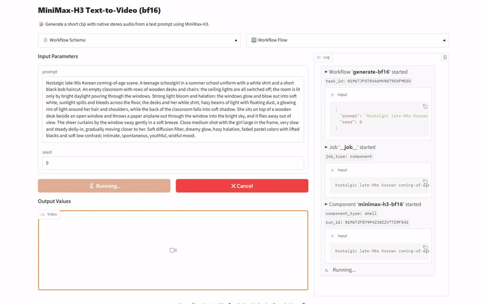
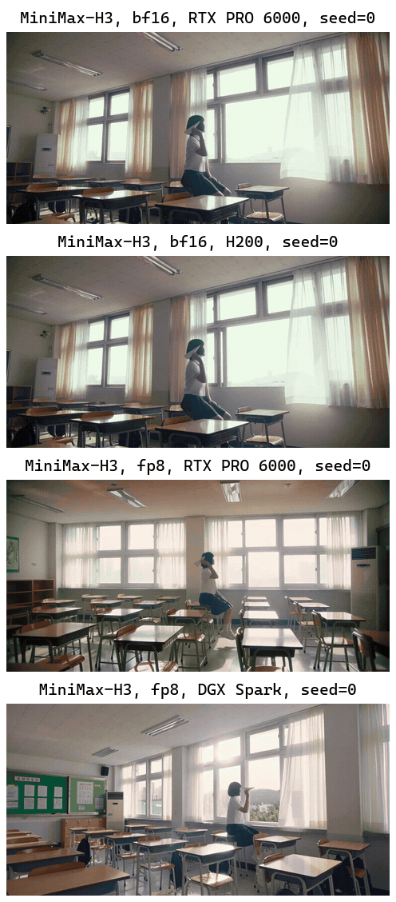

[English](README.md) · [한국어](README.ko.md) · [中文](README.zh.md)

# text-to-video-minimax-h3

This service takes a text prompt and returns a short video file with sound, made with MiniMaxAI/MiniMax-H3.



## Quick Start

It needs [model-compose](https://github.com/hanyeol/model-compose) 0.4.122 or later.

Install with [uv](https://docs.astral.sh/uv/):

```bash
uv pip install model-compose
```

Or with pip:

```bash
pip install model-compose
```

Clone this repository:

```bash
git clone https://github.com/MindrLabs/text-to-video-minimax-h3
cd text-to-video-minimax-h3
```

Run it:

```bash
model-compose up
```

The API listens on http://localhost:8080/api and the Gradio UI opens at http://localhost:8081.

## Summary

bf16 on the H200 and RTX PRO 6000 and fp8 on the RTX PRO 6000 and DGX Spark all produced 1280×640, 24fps, 5.17-second videos, and the sound and prompt-following claims passed a person's check.

| Machine | Status | Settings | RTF | Peak memory (MiB) |
| :---: | --- | --- | --- | --- |
| DGX Spark | Measured | fp8 | 373 | 83447 (VRAM) |
| RTX PRO 6000 | Measured | fp8 | 77.2 | 83964 (VRAM) |
| H200 | Measured | bf16 | 75.4 | 137368 (VRAM) |

## Setup

Measured with model-compose 0.4.122. Statistics use 95% intervals, and speed differences under 1.05× are not called.

| Settings | Inputs | Weights | Claim rules |
| :---: | --- | --- | --- |
| fp8 | 1 input × 3 repeats | [MiniMaxAI/MiniMax-H3](https://huggingface.co/MiniMaxAI/MiniMax-H3/tree/42ed227ee7df40d41602854ae760620d6eb651fe) | duration_sec ≤ 15; fps = 24 |
| bf16 | 1 input × 3 repeats | [MiniMaxAI/MiniMax-H3](https://huggingface.co/MiniMaxAI/MiniMax-H3/tree/42ed227ee7df40d41602854ae760620d6eb651fe) | duration_sec ≤ 15; fps = 24 |

## Results

### Text to Video with Sound

We gave one long English prompt describing a student sitting on a desk in an empty classroom and throwing a paper airplane out of the window, down to the light bloom, camera movement and colors.

| Claim | Check | Machine | Pass |
| :---: | --- | --- | --- |
| Generated video lasts up to 15 seconds. | Checked by rule | DGX Spark | ✓ |
| Generated video lasts up to 15 seconds. | Checked by rule | H200 | ✓ |
| Generated video lasts up to 15 seconds. | Checked by rule | RTX PRO 6000 | ✓ |
| The output follows a complex prompt. | Judged by a person | — | ✓ |
| The output frame rate is 24 FPS. | Checked by rule | DGX Spark | ✓ |
| The output frame rate is 24 FPS. | Checked by rule | H200 | ✓ |
| The output frame rate is 24 FPS. | Checked by rule | RTX PRO 6000 | ✓ |
| The video comes with native stereo audio that belongs to the scene. | Judged by a person | — | ✓ |

We measured on H200, RTX PRO 6000, DGX Spark. RTF is the processing time divided by the length of the audio or video, so lower is faster. Each cell is the median over measured calls, leaving out any call made during other GPU work.

| Settings | Machine | RTF | Seconds per call | Peak memory (MiB) | duration_sec | fps | height | pixels | width |
| :---: | --- | --- | --- | --- | --- | --- | --- | --- | --- |
| bf16 | H200 | 75.4 | 390 | 137368 (VRAM) | 5.17 | 24 | 640 | 819200 | 1280 |
| bf16 | RTX PRO 6000 | 85.3 | 441 | 80060 (VRAM) | 5.17 | 24 | 640 | 819200 | 1280 |
| fp8 | DGX Spark | 373 | 1930 | 83447 (VRAM) | 5.17 | 24 | 640 | 819200 | 1280 |
| fp8 | RTX PRO 6000 | 77.2 | 399 | 83964 (VRAM) | 5.17 | 24 | 640 | 819200 | 1280 |



> Nostalgic late-90s Korean coming-of-age scene. A teenage schoolgirl in a summer school uniform with a white shirt and a short black bob haircut. An empty classroom with rows of wooden desks and chairs: the ceiling lights are all switched off; the room is lit only by bright daylight pouring through the windows. Strong light bloom and halation: the windows glow and blow out into soft white, sunlight spills and bleeds across the floor, the desks and her white shirt, hazy beams of light with floating dust, a glowing rim of light around her hair and shoulders, while the back of the classroom falls into soft shadow. She sits on top of a wooden desk beside an open window and throws a paper airplane out through the window into the bright sky, and it flies away out of view. The sheer curtains by the window sway gently in a soft breeze. Close medium shot with the girl large in the frame, very slow and steady dolly-in, gradually moving closer to her. Soft diffusion filter, dreamy glow, hazy halation, faded pastel colors with lifted blacks and soft low contrast; intimate, spontaneous, youthful, wistful mood.

## Recommendations

- When running fp8 on the DGX Spark, one video took 1921 to 1938 seconds, so we recommend planning for that much time per video.
- bf16 on the H200 uses up to 137368 MiB of GPU memory, so we recommend not running other work on the same GPU.

## Limitations and What We Did Not Measure

- Speed and the person's check used only 1 prompt, so we could not confirm a speed difference between machines.
- The RTX PRO 6000 bf16 median counts the 2 remaining runs, leaving out the run that overlapped other GPU work.

### Measurement Conditions

| Item | Detail |
| :---: | --- |
| Constraint | int4 is not included: it needs the mslk package installed separately, and even with mslk installed it fails on RTX PRO 6000 with model-compose 0.4.122. |
| Constraint | bf16 runs with cpu_offload on, so part of the model sits in CPU memory; fp8 runs without it. |
| Claim rules | Claims with a rule were checked on each machine against the number their source gives. |

### Not Measured

| Subject | Item | Reason |
| :---: | --- | --- |
| DGX Spark vs RTX PRO 6000 | RTF | Only 1 input was measured on both machines without other GPU work, and at least 20 are needed. |
| H200 vs RTX PRO 6000 | RTF | Only 1 input was measured on both machines without other GPU work, and at least 20 are needed. |

### Unchecked Model Card Claims

- The output audio is 32 kHz stereo.
- H3-Context-IR is not included in the open-source release.
- Dialogue is stable in 11 languages.
- The open-source release runs inference with full attention only.
- H3-Regenerate-2K regenerates a 768p result at 2K resolution.
- H3-Base produces results at 768p resolution.

## License

| Covers | License | Commercial use |
| :---: | --- | --- |
| This service | [`LICENSE`](LICENSE) | ✓ |
| MiniMax-H3 weights | [`MODEL_LICENSE`](https://huggingface.co/MiniMaxAI/MiniMax-H3/blob/main/LICENSE) | ✓ |
