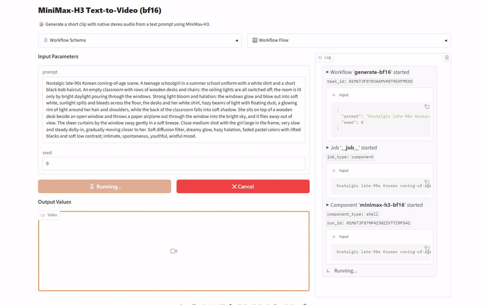
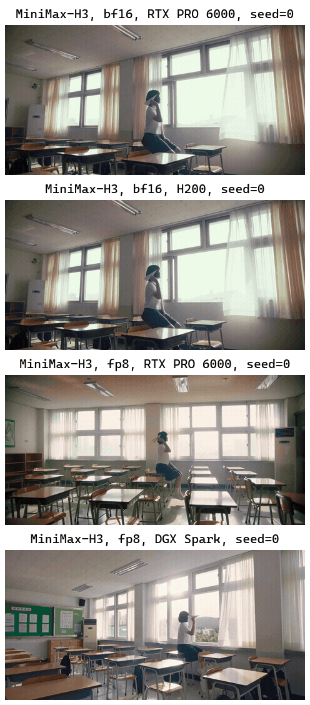

[English](README.md) · [한국어](README.ko.md) · [中文](README.zh.md)

# text-to-video-minimax-h3

这个服务接收英文提示词，用 MiniMaxAI/MiniMax-H3 生成带声音的短视频，并以视频文件返回。



## 快速开始

需要 [model-compose](https://github.com/hanyeol/model-compose) 0.4.122 或更高版本。

使用 [uv](https://docs.astral.sh/uv/) 安装：

```bash
uv pip install model-compose
```

或使用 pip 安装：

```bash
pip install model-compose
```

克隆此仓库：

```bash
git clone https://github.com/MindrLabs/text-to-video-minimax-h3
cd text-to-video-minimax-h3
```

运行：

```bash
model-compose up
```

API 地址为 http://localhost:8080/api ，Gradio 界面地址为 http://localhost:8081 。

## 摘要

H200 和 RTX PRO 6000 上的 bf16，以及 RTX PRO 6000 和 DGX Spark 上的 fp8，都生成了 1280×640、24fps、5.17 秒的视频，声音和遵循提示词的说法也通过了人工判定。

| 设备 | 状态 | 设置 | RTF | 峰值内存 (MiB) |
| :---: | --- | --- | --- | --- |
| DGX Spark | 已测量 | fp8 | 373 | 83447 (VRAM) |
| RTX PRO 6000 | 已测量 | fp8 | 77.2 | 83964 (VRAM) |
| H200 | 已测量 | bf16 | 75.4 | 137368 (VRAM) |

## 测量环境

使用 model-compose 0.4.122 测量。统计使用 95% 置信区间，低于 1.05× 的速度差异不作判定。

| 设置 | 输入 | 权重 | 声明判定规则 |
| :---: | --- | --- | --- |
| fp8 | 1 个输入 × 3 次重复 | [MiniMaxAI/MiniMax-H3](https://huggingface.co/MiniMaxAI/MiniMax-H3/tree/42ed227ee7df40d41602854ae760620d6eb651fe) | duration_sec ≤ 15; fps = 24 |
| bf16 | 1 个输入 × 3 次重复 | [MiniMaxAI/MiniMax-H3](https://huggingface.co/MiniMaxAI/MiniMax-H3/tree/42ed227ee7df40d41602854ae760620d6eb651fe) | duration_sec ≤ 15; fps = 24 |

## 结果

### 文字生成有声视频

我们输入了一段很长的英文提示词，描写学生坐在空教室的课桌上把纸飞机扔出窗外，连光晕、镜头运动和色调都写了进去。

| 声明 | 核对方式 | 设备 | 通过 |
| :---: | --- | --- | --- |
| 生成的视频最长 15 秒。 | 规则判定 | DGX Spark | ✓ |
| 生成的视频最长 15 秒。 | 规则判定 | H200 | ✓ |
| 生成的视频最长 15 秒。 | 规则判定 | RTX PRO 6000 | ✓ |
| 输出会遵循复杂的提示词。 | 人工判定 | — | ✓ |
| 输出帧率为 24 FPS。 | 规则判定 | DGX Spark | ✓ |
| 输出帧率为 24 FPS。 | 规则判定 | H200 | ✓ |
| 输出帧率为 24 FPS。 | 规则判定 | RTX PRO 6000 | ✓ |
| 视频会同时生成与场景相符的立体声音频。 | 人工判定 | — | ✓ |

在 H200、RTX PRO 6000、DGX Spark 上进行了测量。RTF 是处理耗时除以音频或视频时长，越低越快。每格为所测调用的中位数，计算时不计入在其他 GPU 任务期间进行的调用。

| 设置 | 设备 | RTF | 每次调用秒数 | 峰值内存 (MiB) | duration_sec | fps | height | pixels | width |
| :---: | --- | --- | --- | --- | --- | --- | --- | --- | --- |
| bf16 | H200 | 75.4 | 390 | 137368 (VRAM) | 5.17 | 24 | 640 | 819200 | 1280 |
| bf16 | RTX PRO 6000 | 85.3 | 441 | 80060 (VRAM) | 5.17 | 24 | 640 | 819200 | 1280 |
| fp8 | DGX Spark | 373 | 1930 | 83447 (VRAM) | 5.17 | 24 | 640 | 819200 | 1280 |
| fp8 | RTX PRO 6000 | 77.2 | 399 | 83964 (VRAM) | 5.17 | 24 | 640 | 819200 | 1280 |



> Nostalgic late-90s Korean coming-of-age scene. A teenage schoolgirl in a summer school uniform with a white shirt and a short black bob haircut. An empty classroom with rows of wooden desks and chairs: the ceiling lights are all switched off; the room is lit only by bright daylight pouring through the windows. Strong light bloom and halation: the windows glow and blow out into soft white, sunlight spills and bleeds across the floor, the desks and her white shirt, hazy beams of light with floating dust, a glowing rim of light around her hair and shoulders, while the back of the classroom falls into soft shadow. She sits on top of a wooden desk beside an open window and throws a paper airplane out through the window into the bright sky, and it flies away out of view. The sheer curtains by the window sway gently in a soft breeze. Close medium shot with the girl large in the frame, very slow and steady dolly-in, gradually moving closer to her. Soft diffusion filter, dreamy glow, hazy halation, faded pastel colors with lifted blacks and soft low contrast; intimate, spontaneous, youthful, wistful mood.

## 建议

- 在 DGX Spark 上用 fp8 运行时，一个视频耗时 1921 到 1938 秒，建议按每个视频预留这么多时间。
- H200 上的 bf16 最多占用 137368 MiB 显存，建议不要在同一块 GPU 上同时运行其他任务。

## 局限与未测量的内容

- 速度和人工判定只用了 1 个提示词，因此无法确认机器之间的速度差异。
- RTX PRO 6000 的 bf16 中位数去掉了与其他 GPU 任务重叠的那次运行，只用剩下的 2 次计算。

### 测量条件

| 项目 | 内容 |
| :---: | --- |
| 限制 | 未包含 int4：它需要另外安装 mslk 包，而且即使安装了 mslk，在 model-compose 0.4.122 的 RTX PRO 6000 上也会失败。 |
| 限制 | bf16 开启 cpu_offload 运行，模型的一部分放在 CPU 内存中；fp8 不开启。 |
| 声明判定规则 | 带规则的声明已在每台设备上与来源给出的数字对照判定。 |

### 未能测量的内容

| 对象 | 项目 | 原因 |
| :---: | --- | --- |
| DGX Spark 与 RTX PRO 6000 | RTF | 在两台机器上不受其他 GPU 任务影响测得的输入只有 1 个，至少需要 20 个。 |
| H200 与 RTX PRO 6000 | RTF | 在两台机器上不受其他 GPU 任务影响测得的输入只有 1 个，至少需要 20 个。 |

### 未核实的模型卡声明

- 输出音频为 32 kHz 立体声。
- H3-Context-IR 不包含在开源发布中。
- 对白在 11 种语言中都很稳定。
- 开源版本只用 full attention 推理。
- H3-Regenerate-2K 会把 768p 结果重新生成为 2K 分辨率。
- H3-Base 以 768p 分辨率生成结果。

## 许可证

| 适用对象 | 许可证 | 商业使用 |
| :---: | --- | --- |
| 本服务 | [`LICENSE`](LICENSE) | ✓ |
| MiniMax-H3 权重 | [`MODEL_LICENSE`](https://huggingface.co/MiniMaxAI/MiniMax-H3/blob/main/LICENSE) | ✓ |
